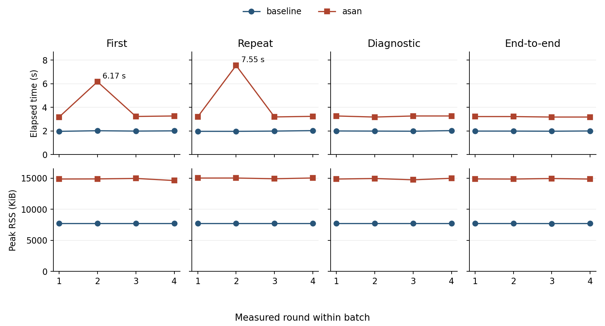

# bzip2 runtime variation and resident memory

**Figure 1.** Each point is one timed compression of the same 32 MiB input.
Columns follow the experiment sequence. Lines connect rounds within each
variant. Warmups and pilot measurements are excluded. The 32 measured runs
all exited successfully.

**Table 1. Paper and reproduction.** Ratios divide ASan by baseline.
The local ranges span the four batch ratios of means. The accompanying
[statistics table](figures/bzip2-batch-stats.csv) lists the mean and sample
standard deviation for each variant, metric and batch (four runs each).

| Metric | Paper | Local bzip2 results | Interpretation |
|---|---|---|---|
| Runtime | Figure 2, 1.73× across SPEC CPU2006 C/C++ workloads | 1.6080–2.1583× | Each batch shows overhead on the synthetic input. These runs alone leave the suite-wide claim inconclusive. |
| Memory | Table 1, 3.37× using VmPeak | 1.9245–1.9460× using peak RSS | Peak virtual address space and peak resident memory measure different quantities. A like-for-like numerical gap cannot be estimated. |

The runtime ratios range from 0.1220 below to 0.4283 above the paper's 1.73
(−7.1% to +24.8% relative to that reference). These are descriptive
differences across workloads and settings. They cannot establish a change
in ASan performance between compiler versions.

**Effect of the slow observations.** ASan round 2 took 6.17 s in the first
batch and 7.55 s in the repeat. All 14 other ASan runs fell between 3.18
and 3.27 s. Round 2 returned to 3.18 and 3.22 s in the diagnostic and
end-to-end batches under the same order. Run position alone therefore
does not consistently predict the slowdown. The ASan sample standard
deviations in Table 1's companion CSV rise from 0.023–0.045 s in the latter
batches to 1.472–2.170 s in the first two. All four observations per variant
contribute to every reported batch mean.

The diagnostic batch collected context switches and page faults, but
neither slow event occurred while these counters were being collected.
Their cause remains unresolved. RSS changed little across batches even
when elapsed time varied.

## Rebuild and trace the results

Use Python 3 and Matplotlib (tested with 3.10.8). From the repository root,
run `python3 scripts/plot_bzip2.py`. It reads the four measurements.csv files
listed in the script from the data at commit a56781d. Each row of the output
CSV names its source directory under results/. Derived figures and tables
use existing team measurements. ChatGPT assisted with plotting, statistics
and drafting the interpretation.

[Original paper, §4.1, Figure 2 and Table 1](https://www.usenix.org/system/files/conference/atc12/atc12-final39.pdf)
